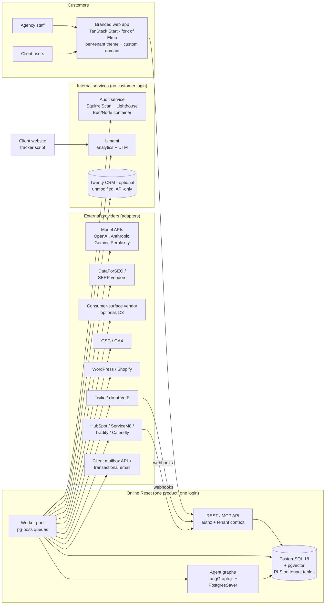
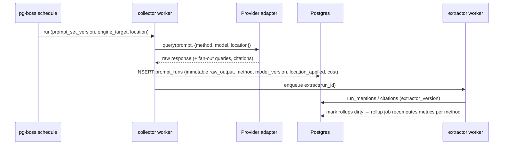
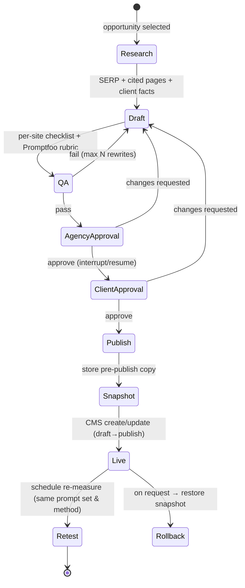

# 05 — Recommended Architecture

## 1. Design summary

The platform is **one TypeScript platform on one PostgreSQL database**, built from a fork of Elmo. Everything a customer touches is the Online Reset frontend.

A small number of internal services run beside it, and no customer ever logs into them:

- **SquirrelScan** (Bun) runs audits.
- **Umami** collects analytics.
- Optionally, **Twenty** provides CRM.

Key choices:

- **Runtime:** Node 24 / TypeScript, using Elmo's TanStack Start web app and its pg-boss worker. This is one language for the app, the workers and the agent graphs.
- **Database:** PostgreSQL 18 with pgvector. It is the single system of record, and it also holds the job queue (pg-boss) and the agent checkpoints (LangGraph.js `PostgresSaver`).
- **No Redis, ClickHouse, JVM or Python in the MVP.** Each would have to justify itself later.
- **Tenant isolation is enforced in the database (RLS policies)** and also in application code. Elmo currently does only the application-level part.
- **Providers are pluggable.** AI engines, SERP/keyword/backlink data, LLMs for drafting and judging, CMS targets and CRMs all sit behind adapters, so a vendor can be swapped without changing the data model.

## 2. Component decisions

| Component | Label | Source | Notes |
|---|---|---|---|
| Web app, API, MCP, portal | **FORK AND MODIFY** | Elmo `apps/web`, `packages/api-spec` | Rebrand; per-tenant theming; new modules. |
| Worker / scheduler / queue | **FORK AND MODIFY** | Elmo `apps/worker` + pg-boss | Add queues: audit, serp, content, publish, outreach, conversion-sync. |
| Data model / migrations | **FORK AND MODIFY** | Elmo Drizzle schema | Extend it (§5); add RLS policies. |
| Auth, orgs, RBAC, SSO | **FORK AND MODIFY** (better-auth) | Elmo `packages/lib/src/auth` | Agency → client hierarchy; new roles. Keycloak is **REJECTED** for now (revisit for enterprise SAML). |
| AI-engine collectors (API) | **FORK** (Elmo) + **REUSE CODE** (Canonry geo) | Elmo `providers/registry/*`, Canonry `provider-*/normalize.ts` | Native `user_location` for NZ cities. |
| AI-engine collectors (consumer surfaces) | **INTEGRATE AS SERVICE** (paid vendor) | Elmo adapters: DataForSEO / Cloro / SearchAPI | Off until owner decision D3. |
| Mention / rank / citation extraction | **REUSE CODE** | Limelit `mentions` (port), Canonry `brand-matching`, Elmo `text-extraction` | Deterministic by default. |
| LLM judge (sentiment, ambiguity) | **FORK AND MODIFY** | Elmo `mention-judge` | Generic transport; optional. |
| SoV, metrics, insights | **REUSE CODE** | Canonry `intelligence`, Limelit methodology | — |
| Prompt clustering | **REUSE CODE** + **INSTALL AS DEPENDENCY** (pgvector) | Canonry `embeddings.ts` | BERTopic **REJECTED** for runtime. |
| SEO data (keywords, SERP, backlinks) | **REUSE CODE** + **INTEGRATE AS SERVICE** (DataForSEO) | OpenSEO `lib/dataforseo/*` | SerpBear adapters are the fallback. |
| Free backlink discovery | **REUSE CODE** | Canonry `integration-commoncrawl` | DuckDB dependency. |
| GSC / GA4 | **REUSE CODE** | OpenSEO `gscClient.ts`, `ga4Client.ts`; SEOMachine heuristics (port) | Free Google APIs. |
| Technical SEO / AEO audit | **INTEGRATE AS SERVICE** (internal) | SquirrelScan CLI/engine in a Bun container | Ingest its JSON; rebrand. |
| Performance audit | **INSTALL AS DEPENDENCY** | Lighthouse (+ Unlighthouse later) | In the audit worker. |
| Agent workflows | **INSTALL AS DEPENDENCY** | LangGraph.js + `@langchain/langgraph-checkpoint-postgres` | Never LangGraph Server/Platform. |
| Content QA | **INSTALL AS DEPENDENCY** (Promptfoo) + **REUSE CODE** (SEOMachine scorers, port) | — | — |
| CMS publishing | **REUSE CODE** | Canonry `integration-wordpress`, Activepieces WP/Shopify pieces (MIT) | Other CMSs: **CUSTOM BUILD**. |
| Proposal engine | **CUSTOM BUILD** | reuses audit, prompt-test and keyword modules | Adaptify parity. |
| Outreach | **CUSTOM BUILD** | Gmail/M365 send-as-client | Human approval required. |
| Web analytics / attribution | **INTEGRATE AS SERVICE** | Umami (internal; one website per client) | Our UI reads its API; customers never see Umami. |
| Missed-call + SMS | **CUSTOM BUILD** | Twilio Voice/SMS webhooks (or client VoIP) | Chatwoot EE missed-call code **REJECTED** (licence). |
| CRM | **INTEGRATE AS SERVICE** (client's CRM) | HubSpot (Activepieces piece logic), ServiceM8/Tradify/Fergus (custom) | Twenty is optional and API-only (D5). |
| Inbox / chat | **REJECT for MVP** | Chatwoot FOSS later if needed | — |
| Email sending (ours) | **INTEGRATE AS SERVICE** | Transactional email provider (not chosen; D6) | Listmonk **REJECTED** for MVP. |
| Dashboards / reports | **FORK** (Elmo reports) + **INSTALL AS DEPENDENCY** (Playwright PDF) | — | Superset and Appsmith **REJECTED**. |
| LLM tracing | **REUSE CODE** (Langfuse price table) | Elmo `usage_events` | The Langfuse service is deferred. |
| Evals / regression tests | **INSTALL AS DEPENDENCY** | Promptfoo (CI) | Telemetry off. |
| Local POC models | **INTEGRATE AS SERVICE** (dev only) | Ollama | Never treated as a monitored engine. |
| Automation platforms | **REJECT** | Windmill, Activepieces (platform), Flowise, Langflow | — |
| CMS hosting | **REJECT** | Strapi | — |
| CRMs / marketing / booking | **REJECT** | EspoCRM, Mautic, Matomo, Easy!Appointments | — |
| Consumer-UI scraping | **REJECT** | OneGlanse, Canonry `provider-cdp`, SerpBear `proxy` | — |

## 3. System diagram



## 4. Main data flows

### 4.1 Visibility test cycle



### 4.2 Content and publishing (agent graph with approval)



### 4.3 Conversion signals

The client site's tracker, enquiry forms, call webhooks and CRM/booking webhooks feed an `events` table. Each event carries its source and an attribution class. A nightly job joins those events to visibility and content changes, then writes `outcome_reports`. Every figure in those reports carries its attribution class (see 04).

## 5. Data and evidence model (extensions to Elmo)

New or changed tables. Every tenant table gets `tenant_id uuid not null` plus an RLS policy.

| Table | Purpose / key columns |
|---|---|
| `tenants` | Agency org (maps to better-auth `organization`), plan, branding (logo, colours, domain) |
| `clients` | Business under an agency: profile, objectives, `service_areas[]`, timezone |
| `prompt_sets`, `prompt_set_versions` | **Frozen** prompt lists per test cycle; clusters (`cluster_id`, embedding `vector(…)`) |
| `engine_targets` | `engine`, `collection_method`, `provider`, `model`, `grounded bool`, `location {country,region,city,lang}` |
| `prompt_runs` (Elmo, extended) | add `collection_method`, `location_requested`, `location_applied`, `methodology_version`, `cost_micros` |
| `serp_snapshots` | keyword, location code, device, raw JSON, provider |
| `audit_runs`, `audit_findings` | SquirrelScan / Lighthouse output, rule id, severity, page, fingerprint |
| `opportunities` | type (geo, seo, conversion), score components, status |
| `change_tickets` | acceptance criteria, linked opportunity, verification result |
| `content_items`, `content_versions`, `qa_results` | Drafts, checklist results, rubric scores |
| `approvals` | subject, required role, decision, actor, timestamp, LangGraph `thread_id` |
| `publications` | CMS target, remote id, **pre-publish snapshot**, published version, rollback pointer |
| `outreach_prospects`, `outreach_messages` | Consent basis, approval, sent-from mailbox, replies |
| `events` | Conversion events: `source`, `attribution_class`, UTM, session id, value |
| `integrations` | Per-client OAuth tokens (encrypted, via the Elmo secrets store) |
| `audit_log` | Every user/agent action (append-only) |
| `agent_events` | Node-level agent logs; LangGraph checkpoints live in their own tables |

**Evidence invariants**
1. Raw provider output is immutable. Elmo already enforces this with a trigger on `prompt_runs`.
2. Every metric records the methodology version, extractor version and `n`.
3. Metrics are never aggregated across `collection_method`.
4. Reports cite run IDs.

## 6. Tenant isolation (must be built; it does not exist today)

What Elmo does today:
- It filters by `organization_id` in application code.
- Its tables call `.enableRLS()`, but there are **no policies**.

Required changes:

1. Create two database roles: `app_rw`, which is a non-owner and **not** BYPASSRLS, and a separate migration owner role.
2. Add a policy on every tenant table, and force RLS:

   ```sql
   CREATE POLICY tenant_isolation ON <t> USING (tenant_id = current_setting('app.tenant_id')::uuid) WITH CHECK (same);
   ALTER TABLE <t> FORCE ROW LEVEL SECURITY;
   ```

3. Every request and every job opens a transaction with `SET LOCAL app.tenant_id = …`. That value comes from server-side session or job metadata, never from client input. Pooling must be transaction-scoped, not session-scoped.
4. A client-level sub-scope (`app.client_ids`) restricts client users to their own businesses.
5. Workers that legitimately span tenants, such as the scheduler, use a separate role with audited access.
6. CI runs isolation tests. For every API route and MCP tool, a cross-tenant read or write must fail. OpenSEO's `tests/mcp-tenant-isolation.spec.ts` is the pattern to follow.
7. Per-tenant secrets are encrypted with Elmo's secrets store. Plan key rotation.

## 7. Provider interfaces (TypeScript contracts)

```ts
// AI engine (extends Elmo Provider)
interface EngineAdapter {
  id: string; engine: 'chatgpt'|'claude'|'gemini'|'perplexity'|'copilot'|'google_aio'|'google_ai_mode';
  method: 'model_api_grounded'|'model_api_ungrounded'|'consumer_surface_via_vendor'|'manual_capture';
  run(q: { prompt: string; location?: GeoTarget; model?: string; version?: string }):
    Promise<{ raw: unknown; text: string; citations: Citation[]; fanout?: string[];
              modelVersion?: string; locationApplied: 'native'|'prompt_text'|'none'; costMicros: number }>;
}
interface SerpAdapter   { search(k: string, loc: GeoTarget, device: 'desktop'|'mobile'): Promise<SerpResult> }
interface KeywordAdapter { ideas(seed: string[], loc: GeoTarget): Promise<KeywordMetric[]> }
interface BacklinkAdapter { referringDomains(domain: string): Promise<LinkRow[]> }
interface LlmAdapter     { complete(req: ChatRequest): Promise<ChatResponse>; embed(t: string[]): Promise<number[][]> } // OpenAI-compatible; Ollama in dev
interface CmsAdapter     { createDraft(c: Content): Promise<RemoteRef>; publish(r: RemoteRef): Promise<void>;
                           snapshot(r: RemoteRef): Promise<Snapshot>; restore(s: Snapshot): Promise<void> }
interface CrmAdapter     { pullLeads(since: Date): Promise<Lead[]>; pullDeals(since: Date): Promise<Deal[]>; webhook(req): Event[] }
interface TelephonyAdapter { onCallStatus(req): CallEvent; sendSms(to: string, templateId: string, consentRef: string): Promise<void> }
```

External API, exposed by Online Reset. Elmo's existing REST, OpenAPI and MCP is extended with:
`/clients`, `/prompt-sets`, `/runs`, `/metrics`, `/audits`, `/opportunities`, `/content`, `/approvals`, `/publications`, `/events`, `/reports`. Every endpoint is tenant-scoped by the auth token.

## 8. Deployment shape

| Scale | Shape |
|---|---|
| POC | One local machine with Docker Compose: `postgres+pgvector`, `web`, `worker`, `audit` (Bun), `umami`, `ollama`. |
| Pilot / 10 clients | One VM (sized in 07) plus managed Postgres with point-in-time recovery, and object storage for screenshots and PDFs. |
| 50 clients | Separate VMs or containers for web and workers. Scale the audit/browser workers horizontally. Add a Postgres read replica for reporting. |

## 9. Dependency risks

| Risk | Mitigation |
|---|---|
| The Elmo fork drifts from upstream | Keep Online Reset code in new packages (`packages/or-*`) and rebase periodically. Record every patch to Elmo core. |
| SquirrelScan is pre-1.0 with fast churn and a Bun runtime | Pin the version. Treat its JSON output as a contract and test it with golden fixtures. |
| Vendor ToS or API changes (consumer-surface data) | Keep it optional. Its metrics are isolated by method. Have two vendors' adapters ready (Elmo already has six). |
| DataForSEO lock-in | SerpBear adapters as a fallback. Common Crawl for backlinks. |
| LLM price or model changes | Adapter layer, cost metering per run, per-client budget caps. |
| AGPL creep | A CI licence check (Elmo has `scripts/check-licenses.mjs`) that blocks GPL/AGPL/FSL/EE paths from entering the codebase. |
| Crawl4AI security history | Not in the MVP. If added later, run it only behind an SSRF guard and never expose its server. |
