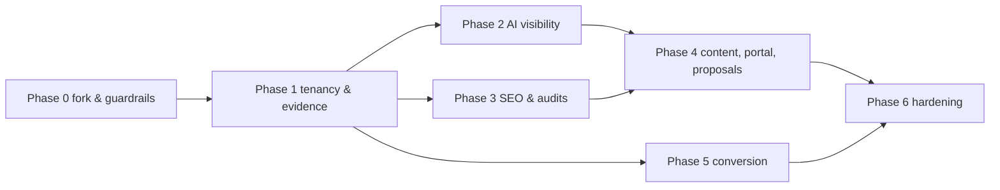

# 08 — Phased Development Plan

**Nothing in this plan starts until the owner approves it** (see 10, decisions D1–D9). Each phase has objective acceptance criteria. A phase is complete only when all of its criteria pass in CI or in a recorded demo.

## Phase 0 — Fork, hygiene, guardrails (NZ$0)

**Depends on:** approval of the overall plan (D8), and the advisory check (D7).

| Step | Work |
|---|---|
| 0.1 | Fork Elmo at a pinned commit (audited: `db2d52b`) into a private Online Reset repository. Keep upstream as a remote. |
| 0.2 | Remove PostHog telemetry (`apps/worker/src/telemetry.ts`), the Elmo branding and `apps/www`. Add a NOTICE and a credits file. |
| 0.3 | Review the install scripts of Elmo's dependencies, then install them locally and run Elmo's existing test suite. |
| 0.4 | CI guardrails: a licence scan (extend `scripts/check-licenses.mjs`) and a path deny-list for EE/FSL directories. Run Promptfoo with telemetry off. |
| 0.5 | Local Docker Compose: Postgres + pgvector, web, worker, Ollama. |

**Acceptance criteria**
- Elmo's existing tests pass on the fork.
- No outbound telemetry, confirmed by running the stack with egress logging.
- The CI licence check fails on a deliberately added AGPL test dependency.
- The stack starts with one command.

## Phase 1 — Tenancy, isolation and the evidence model (NZ$0)

| Step | Work |
|---|---|
| 1.1 | Add the tenant → client hierarchy, the five roles and the per-tenant branding table. |
| 1.2 | **RLS policies** on every tenant table, with `SET LOCAL app.tenant_id` set per request and per job, and a non-owner DB role. |
| 1.3 | Evidence fields: `collection_method`, `location_requested`, `location_applied`, `methodology_version`, and frozen `prompt_set_versions`. |
| 1.4 | Append-only `audit_log`. |

**Acceptance criteria**
- An automated cross-tenant test suite covers 100% of REST routes and MCP tools: every cross-tenant read or write returns 403 or 404, and the DB returns 0 rows when the app filter is bypassed.
- Raw run output cannot be updated: an UPDATE attempt fails.
- Metric queries refuse to mix collection methods, enforced by a unit test.

## Phase 2 — AI visibility engine (NZ$0 locally; first paid test needs D2)

| Step | Work |
|---|---|
| 2.1 | Port Canonry `user_location` handling into Elmo's OpenAI and Anthropic providers. Port the Perplexity and Gemini providers. |
| 2.2 | Replace the hard-coded `DFS_LOCATION_CODE = 2840` with a per-target location. Add the NZ location catalogue, using the Limelit map plus DataForSEO location IDs. |
| 2.3 | Port the Limelit matcher to TS as the default extractor, and port the Go tests. Make the Elmo Jev judge optional, behind a generic LLM transport. |
| 2.4 | Swap in Canonry's SoV frame (with publication floors) and the Limelit denominator rules. |
| 2.5 | Prompt discovery: Elmo `suggestPrompts` + Limelit templates + Canonry clustering on pgvector. Add a prompt-approval step. |
| 2.6 | **Controlled paid test** (D2): 120 grounded calls, as specified in 07 §5. |

**Acceptance criteria**
- The ported matcher passes every case from Limelit's original test suite, plus 50 NZ-specific golden fixtures.
- Each run records the method, model, model version, location applied, raw output and cost.
- The paid test produces per-engine visibility, citations and run-to-run variance for Auckland.
- Measured cost per call has replaced the assumptions in 07.
- The app boots with no TypeSafe or OpenRouter key.

## Phase 3 — SEO data, audits, opportunities (provider costs need D2)

| Step | Work |
|---|---|
| 3.1 | Copy the OpenSEO DataForSEO client: keywords, SERP, backlinks. Re-host rank-check jobs on pg-boss. Add a SerpBear adapter as fallback. |
| 3.2 | GSC and GA4 OAuth (OpenSEO clients), plus SEOMachine opportunity heuristics ported to TS. |
| 3.3 | Audit service: a SquirrelScan container plus Lighthouse. Ingest findings and compute SEO, GEO and combined scores. |
| 3.4 | Common Crawl backlink discovery (Canonry). |
| 3.5 | Opportunity scoring v1 (see 09 §3). |

**Acceptance criteria**
- Rank checks for 100 keywords in Auckland complete with retries, and DLQ alerts fire on a forced failure.
- An audit of a test site produces at least 300 evaluated rules, with stable fingerprints across reruns.
- The opportunity list is reproducible from stored data: the same inputs give the same ranking.

## Phase 4 — Content, approval, publishing; client portal (Adaptify parity)

| Step | Work |
|---|---|
| 4.1 | LangGraph.js content graph with `PostgresSaver`: research → draft → QA (per-site checklist of at least 20 checks, plus Promptfoo rubric) → bounded rewrite → agency approval → client approval. |
| 4.2 | Publishing to WordPress (Canonry client, Yoast/RankMath meta) and Shopify (Activepieces logic), with a snapshot and rollback. |
| 4.3 | Client portal: per-tenant branding, custom domain, approvals inbox, reports (PDF via Playwright, with summaries citing run IDs). |
| 4.4 | Proposal engine: prospect URL → audit + prompt test + keyword snapshot → branded proposal, with view tracking and a Day 3/7/14 follow-up sequence that includes an opt-out. |
| 4.5 | Change tickets with acceptance criteria and auto-verify after a re-crawl (GeoLook concept). Retesting uses the same frozen prompt set. |

**Acceptance criteria**
- No content reaches a CMS without an `approval_id`, checked by a test.
- Rollback restores byte-identical prior content on the WordPress test site.
- A proposal can be generated for a test prospect in under 10 minutes of wall time.
- A verified-docs Adaptify parity checklist (01 "Confirmed baseline", items 1–9) is demonstrated end to end.

## Phase 5 — Conversion engine (messaging costs need D2 and D5)

| Step | Work |
|---|---|
| 5.1 | Umami internal service. Website provisioning per client. AI-assistant referrer classification (our own list). |
| 5.2 | Enquiry webhook endpoint that stamps the session and UTM. CRM connectors: HubSpot (Activepieces logic), then ServiceM8, Tradify or Fergus, depending on pilot client needs. |
| 5.3 | Missed-call detection from Twilio Voice status callbacks or client VoIP webhooks. SMS follow-up uses templates, consent records and an opt-out. |
| 5.4 | First-response-time computation (Chatwoot algorithm, ported), using business hours. |
| 5.5 | Outcome reports: visibility → enquiry → booking → revenue, with an attribution class on every figure. |

**Acceptance criteria**
- Every number in an outcome report carries one of the four attribution classes, and "unknown" is never redistributed.
- A simulated missed call produces an SMS job only when a consent record exists.
- FRT matches a hand-computed fixture.

## Phase 6 — Hardening for paid clients

| Step | Work |
|---|---|
| 6.1 | External penetration test focused on tenant isolation, SSRF and authentication. |
| 6.2 | Backups, PITR restore drill, and a retention policy. |
| 6.3 | Langfuse (internal) if trace volume justifies it. Keycloak if an enterprise client needs SAML. |

**Acceptance criteria**
- No critical or high pen-test findings remain open.
- A restore drill completes within the agreed RTO.

## Dependency graph

## What Claude Code should build first (once approved)

Build **Phase 0, then Phase 1**: the fork, removing telemetry, licence guardrails, and then **database-enforced tenant isolation plus the evidence model**. Everything else depends on these. They cost nothing beyond developer time, and they remove the largest security gap found in the base code.
